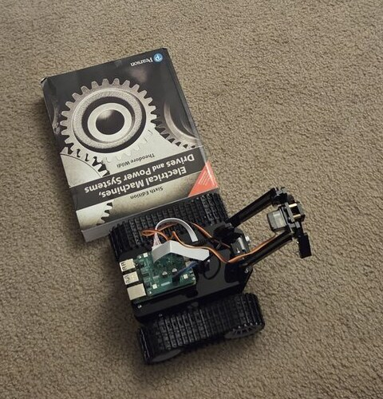
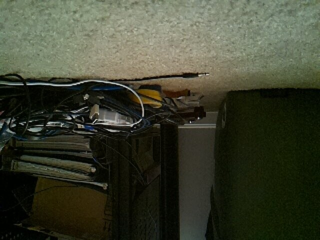
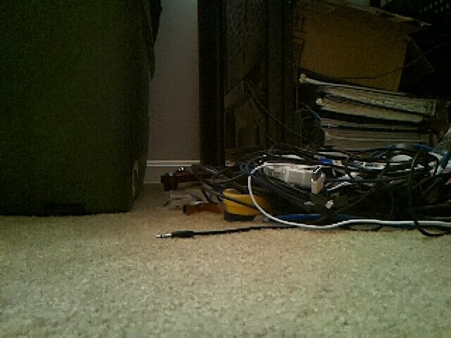
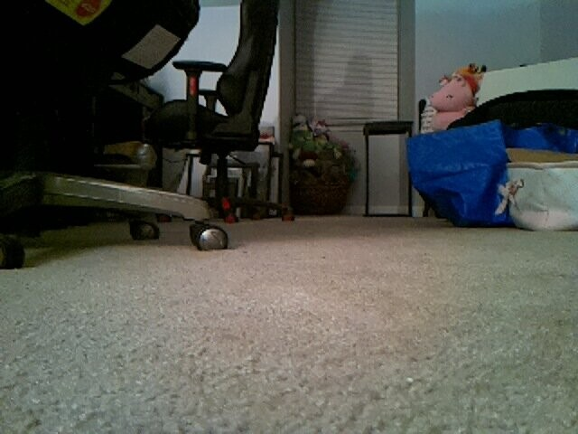
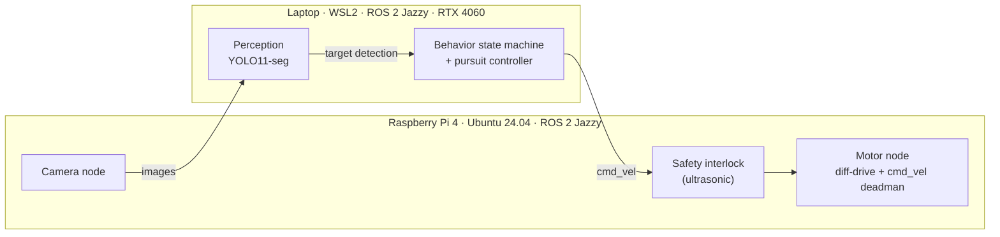

# Vision-Guided Pursuit Robot

A tracked robot that finds my cat with a camera and follows her at a polite distance.

Built on a Freenove Tank Robot Kit (Raspberry Pi 4) running ROS 2 Jazzy, with perception on a laptop GPU. The goal is perception-based pursuit, not map-based navigation: see the target, steer toward her, stop at a safe standoff, and search when she disappears.



## Progress

| When | Milestone | Evidence |
|---|---|---|
| Jun 2026 | **Session 1:** real-time YOLO11 object detection on a live webcam (RTX 4060, CUDA) | [Demo video](#session-1-yolo11-on-a-webcam), [script](prototypes/yolo_webcam.py) |
| Jul–Sep 2026 | **Phase 0:** robot assembled; 5 of 6 subsystems pass acceptance tests; drivetrain and camera measured on carpet | [Test photos and video](#test-evidence), [hardware notes](docs/hardware-setup.md), [bench checklist](docs/phase0_bench_checklist.md) |
| Oct 2026 | **Phase 1:** ROS 2 Jazzy running across the Pi and the laptop over home WiFi; link measured; three stacked faults found and fixed | [Networking write-up](docs/networking.md) |
| Next | **Phase 2:** camera node on the Pi (`image_raw`, `camera_info`) with checkerboard calibration | |
| Planned | **Phase 3:** YOLO11 segmentation on the laptop, then a YOLOX port | |
| Planned | **Phase 4:** search/track state machine, visual servoing, safety interlock | |

## Test evidence

### Camera: OV5647 at 640×480

| Raw capture: the sensor is mounted upside down | Same scene with the 180° correction applied | Robot's-eye view from 8 cm off the floor |
|---|---|---|
|  |  |  |

### Top speed on carpet

Three timed runs at full PWM for 2.0 s each covered 194.5, 195.5, and 196.5 cm, an average of 0.98 m/s. This clip plays the three runs side by side, synced to the moment each one starts.

<!-- VIDEO: on github.com, edit this file and drag speed-runs.mp4 onto this line -->

### Session 1: YOLO11 on a webcam

<!-- VIDEO: on github.com, edit this file and drag session_1_demo.mp4 onto this line -->

## Engineering approach

- **Measure under operating conditions.** Drivetrain numbers come from the carpet the robot will drive on. Network numbers come from the actual Pi-to-laptop path (iperf3), not an internet speed test.
- **Test one layer at a time.** A silent ROS 2 link had three independent causes: a stale DDS address, no multicast between the machines, and a firewall blocking traffic the Pi started. Each was isolated with a test that exercised one layer only.
- **Check power first.** Twice, a sagging 18650 pack looked like a WiFi problem. The battery gets metered before any network theory.
- **Design safety in from the start.** The planned ultrasonic interlock runs on the Pi, between the controller and the motors, so it keeps working if WiFi drops. It fails safe on a bad reading, and its trigger distance is sized like a light-curtain safety distance.

## Architecture

The Pi runs thin hardware nodes; the laptop's RTX 4060 runs inference. They communicate over DDS on home WiFi.



Planned ROS 2 packages:

| Package | Runs on | Role |
|---|---|---|
| `tank_hardware` | Pi | Camera, motor, servo, and ultrasonic nodes |
| `tank_perception` | Laptop | Segmentation and target detection |
| `tank_control` | Laptop (or Pi) | Behavior state machine and pursuit controller |
| `tank_interfaces` | Both | Custom `TargetDetection` message |
| `tank_description` | Both | URDF (camera height, track geometry) |
| `tank_bringup` | Both | Launch files and `params.yaml` |

## Measured parameters

All measured on the carpet the robot will actually drive on, so they reflect operating conditions rather than a bench.

| Parameter | Value | Method |
|---|---|---|
| Track separation | 0.143 m | Centerline to centerline |
| Top speed at full PWM (4095) | 0.98 m/s | Average of three 2.0 s runs: 194.5, 195.5, 196.5 cm |
| Minimum PWM to move (stiction floor) | 750 (18.3% duty) | Free-spin, warm, and cold-start sweeps all converged near 750 |
| Camera lens height | 0.080 m | Floor to lens; used for ground-plane distance estimates |
| Camera rotation | 180° | Sensor is mounted inverted; corrected at capture |

The motor node caps PWM at 2500 for drivetrain headroom, so usable top speed is lower than 0.98 m/s and will be re-measured at that ceiling. At low speed the left track breaks free slightly before the right; closed-loop control will compensate.

Details: [docs/hardware-setup.md](docs/hardware-setup.md)

## Network performance

Measured between the Pi and the laptop on home WiFi with iperf3 and ping:

| Measurement | Result |
|---|---|
| TCP throughput, Pi → laptop (the camera direction) | ~110 Mbit/s |
| TCP throughput, laptop → Pi | ~95 Mbit/s |
| Round-trip time, idle | ~8 ms |
| First reply after idle, WiFi power save on | 158 ms |
| First reply after idle, WiFi power save off | ~7 ms |

Getting ROS 2 to talk across this network meant fixing three independent faults. The write-up is in [docs/networking.md](docs/networking.md).

## Design decisions

- **ROS 2 Jazzy**, for its long-term support (end of life May 2029).
- **YOLO11 first, YOLOX later.** Ultralytics YOLO11 is the fastest way to learn segmentation; YOLOX (Apache 2.0) is the deployment target for licensing reasons.
- **Segmentation masks, not bounding boxes.** The mask centroid gives a better bearing than a box center, and the mask's shape gives a better distance estimate.
- **Split compute.** Segmentation on the Pi's CPU would be far too slow, so the Pi captures and actuates and the laptop GPU runs inference.
- **No SLAM, for now.** The robot needs to see the cat and drive toward her, not localize on a map. Visual SLAM is a stretch goal.
- **Freenove's code stays out of this repo.** It's licensed CC BY-NC-SA 3.0, so the hardware nodes import Freenove's drivers from their own folder instead of copying them.

## Behavior design (planned)

A state machine, because that's how I'd model it on a PLC:

- **SEARCHING:** the cat isn't in view. Rotate toward the side she was last seen, in steps with pauses, so the detector gets sharp frames instead of motion blur.
- **TRACKING:** turn rate is proportional to her bearing. Forward motion is permitted only while she's near the center of the frame, with hysteresis so it doesn't chatter at the edge. Stop at a standoff of about 0.5 m.
- **Target loss:** if she's gone for N seconds, return to SEARCHING. After a full sweep without finding her, go idle rather than wander.
- **Safety interlock:** runs on the Pi between `cmd_vel` and the motors, so it keeps working if the laptop or WiFi drops. It blocks only forward motion, treats a failed sonar reading as an obstacle, and sizes its trigger distance like a light-curtain safety distance: approach speed × total response time + margin, including the sensor driver's ~0.25 s smoothing lag. Ultrasound reflects poorly off fur, so the camera standoff, not the sonar, is what protects the cat.

Controller roadmap: proportional bearing and range control first; then pure pursuit with the cat as the lookahead point, using dynamic-window handling (as in DWPP) so velocity and acceleration limits don't bend the commanded arc.

## Repository layout

```
.
├── README.md
├── docs/
│   ├── hardware-setup.md           Freenove bring-up, acceptance tests, calibration
│   ├── networking.md               Getting ROS 2 working over home WiFi
│   └── phase0_bench_checklist.md   Phase 0 bench checklist
├── media/                          Photos (videos are hosted by GitHub)
│   ├── camera-corrected.jpg
│   ├── camera-floor-view.jpg
│   ├── camera-raw-upside-down.jpg
│   ├── robot.jpg
│   └── session_1_demo.mp4
└── prototypes/
    └── yolo_webcam.py              Session 1: YOLO11 on a webcam
```

## Related projects

Earlier builds this one draws on:

- [led-fsm-arduino](https://github.com/TheThriftyLog/led-fsm-arduino): a non-blocking LED state machine on an Arduino Uno, with edge detection and software debouncing.
- [fsm-ros2-bridge](https://github.com/TheThriftyLog/fsm-ros2-bridge): the same state machine published into ROS 2 Jazzy and carried across two machines over Cyclone DDS, packaged with Docker.
- [avr-assembly-led-blink](https://github.com/TheThriftyLog/avr-assembly-led-blink): bare-metal AVR assembly on the ATmega328P, driving GPIO through direct register writes.

## Third-party software

- [Freenove Tank Robot Kit for Raspberry Pi](https://github.com/Freenove/Freenove_Tank_Robot_Kit_for_Raspberry_Pi): CC BY-NC-SA 3.0. Used, not included.
- [Ultralytics YOLO11](https://github.com/ultralytics/ultralytics): AGPL-3.0.
